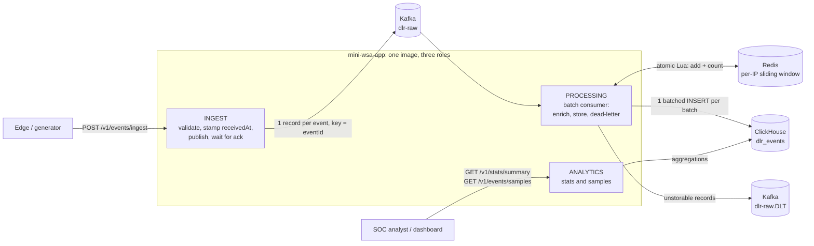

# Mini WSA: Security Analytics Pipeline

A small version of Akamai's Web Security Analytics. It ingests security events (DLRs), classifies and scores them, stores them in ClickHouse, and serves statistics and samples over a REST API. A generator produces realistic traffic, including attack waves.

```
POST /v1/events/ingest ──► Kafka ──► enrich (attack type, threat score, repeat-offender window in Redis) ──► ClickHouse
GET  /v1/stats/summary ◄──────────────────────────────────────────────────────────────────────────────────────┤
GET  /v1/events/samples ◄─────────────────────────────────────────────────────────────────────────────────────┘
```

- **Stack:** Java 25, Spring Boot 4.1, Kafka (KRaft), Redis, ClickHouse, Docker Compose, Testcontainers
- **Modules:** `mini-wsa-app` (the service) and `mini-wsa-generator` (load generator CLI)

## Contents
1. [Quick start](#quick-start)
2. [Architecture](#architecture)
3. [Storage choice](#storage-choice-clickhouse)
4. [Build, test and run](#build-test-and-run)

## Quick start

Requires Docker with Compose v2.

```bash
docker compose up -d --build --wait                 # Kafka, Redis, ClickHouse and the app on :8080
docker compose run --rm generator --count 10000     # 10k events, 30% in attack waves
curl -s localhost:8080/v1/stats/summary | jq
curl -s 'localhost:8080/v1/events/samples?category=INJECTION&limit=5' | jq
```

If port 8080 is busy, run `APP_PORT=18080 docker compose up -d --build --wait` and use that port.

Ingested events become queryable after a short delay, usually under 2 seconds (see [Consistency model](#consistency-model)).

## Architecture



### Request path
1. **Ingest** (`POST /v1/events/ingest`) accepts one event or an array. Validation is all-or-nothing: any invalid event rejects the batch with an itemized 400. Valid events get a server-side `receivedAt` and are published to Kafka, one record per event, keyed by `eventId`. The API answers **201 only after Kafka acknowledged every record** (`acks=all`), so a 201 means the data is stored durably.
2. **Processing** consumes batches of up to 1,000 records:
   - It sorts each batch by event time.
   - It records every event in a per-client-IP sliding window in Redis and counts that IP's earlier events in the 10 minutes before the event. One atomic Lua script per event does this, and all scripts of a batch go in one pipelined round trip.
   - It computes `attackType` and `threatScore`.
   - It writes the batch to ClickHouse with a single INSERT.
   - It sends records that cannot be stored to a dead-letter topic.
   - Only after all of that does it commit Kafka offsets.
3. **Analytics** answers `GET /v1/stats/summary` and `GET /v1/events/samples` directly from ClickHouse.

### Why a queue between ingest and storage
Attack bursts are exactly when DLR volume spikes. Kafka absorbs those spikes, so a slow or restarting database never blocks HTTP threads or loses data: consumers just fall behind and catch up. It also separates write throughput from query load.

### Failure handling in one sentence
Every processing step is idempotent, so on any failure the whole batch is simply processed again:
- The Redis window ignores eventIds it already holds.
- ClickHouse collapses re-inserted rows (`ReplacingMergeTree`).
- Offsets are committed last.

### Roles: one image, three jobs
`miniwsa.roles` (env `MINIWSA_ROLES`, default `ingest, processing, analytics`) decides which components a process creates. Locally and in the default compose, one container runs all three. In production, the same image can run as separately scaled services, e.g. 3 ingest, 2 processing, 1 analytics; see [Roles and split deployment](#roles-and-split-deployment). Health checks follow the roles: an ingest-only instance does not check ClickHouse or Redis.

### Code layout (`mini-wsa-app`)
| Package | Contents |
|---|---|
| `ingest` | Controller, payload parser, validator, size filter, Kafka publisher |
| `processing` | Batch consumer, enrichment, attack-type classifier, threat-score calculator, Redis window, dead-letter publisher, metrics |
| `storage` | Repository interfaces (`EnrichedEventWriter`, `EventAnalyticsReader`) and their ClickHouse implementations, schema |
| `analytics` | Stats and samples controllers/services, cursor paging |
| `domain` | Immutable records and enums (scores and labels live on the enums) |
| `api` | Response DTOs, RFC 9457 error handling |
| `config` | Roles, clock, role-based health defaults |

## Storage choice: ClickHouse

The workload is append-only, high-volume writes plus aggregation-heavy reads (counts, averages and top-N over time ranges), the classic OLAP shape. ClickHouse is a columnar store built for it:

- **Aggregations read only the columns they need**, compressed, vectorized. Counting by category over a billion rows touches a few bytes per row.
- **High insert throughput** with large batched inserts, which is exactly what the Kafka consumer produces.
- **Native features this design relies on:** `ReplacingMergeTree` for idempotent writes, `GROUPING SETS` for consistent multi-level aggregates, partition pruning, `Enum8` and `LowCardinality` encodings.

Alternatives considered:

| Option | Why not |
|---|---|
| PostgreSQL / MySQL | Row stores: aggregations scan whole rows, and indexes slow down the heavy write path. Fine at small scale, not at "millions of DLRs". |
| Elasticsearch / OpenSearch | Good for search and samples, but aggregations at this volume cost far more memory and disk. Ingestion is heavier. |
| Druid / Pinot | Strong real-time OLAP, but much heavier to operate for this scope. ClickHouse gives similar query performance with one container. |
| Cassandra | Excellent writes, but no ad-hoc aggregations. Every stat would need its own pre-built table. |

### Table design (`mini-wsa-app/src/main/resources/clickhouse/schema.sql`)
```sql
ENGINE = ReplacingMergeTree(received_at)
PARTITION BY toYYYYMMDD(timestamp)
ORDER BY (config_id, timestamp, event_id)
```
- **`ORDER BY (config_id, timestamp, …)`:** the typical query is one customer configuration over a time range. With `config_id` first, ClickHouse reads only that configuration's rows. Timestamp-first would read every configuration's rows in the range: about 1,000× more data with 1,000 configurations.
- **Daily partitions** prune time ranges when `configId` is omitted. Duplicates of an event share its timestamp, so they always land in the same partition, which lets them merge.
- **`event_id` last** makes the key unique per event. `ReplacingMergeTree` uses it to collapse re-deliveries and client retries.
- **`Enum8`** (category, action, severity) and **`LowCardinality(String)`** (policy, host, method, geo, attack type) keep repeated values tiny. Optional fields are `Nullable`.
- **No skip indexes:** no API filters by IP or path (they are only grouped by), and category/action are too dense to skip any granule.

### Why not JPA
JPA/Hibernate assumes transactions, row-by-row writes and mutable entities. ClickHouse has none of these, and it penalizes small inserts (`TOO_MANY_PARTS`). Persistence therefore goes through capability-named repository interfaces implemented with Spring `JdbcClient`/`JdbcTemplate`, and all SQL and ClickHouse settings stay inside the `storage` package. The project's `CLAUDE.md` was amended accordingly.

## Build, test and run

### Prerequisites
- Java 25 and Maven 3.8+ (the build uses the Spring Boot 4.1 parent)
- Docker: the integration tests use Testcontainers, and the stack runs with Compose

### Build and test
```bash
mvn clean verify
```
This runs about 210 tests:
- unit tests: classification, scoring, validation, the Redis window, row mapping, cursor paging, the generator
- integration tests with real Kafka, Redis and ClickHouse containers, including an end-to-end test through the REST API

### Run with Docker Compose
```bash
docker compose up -d --build --wait       # infrastructure + app (all roles) on :${APP_PORT:-8080}
docker compose logs -f app
docker compose down                        # stop; data is kept in named volumes
docker compose down -v                     # stop and delete all data
```
Defaults (ports, credentials, partitions, replicas) live in [`.env`](.env).

### Run the app from the IDE or Maven
```bash
docker compose up -d kafka kafka-init redis clickhouse --wait
CLICKHOUSE_USER=miniwsa CLICKHOUSE_PASSWORD=miniwsa mvn -pl mini-wsa-app spring-boot:run
```
The app connects to `localhost:9092`, `localhost:6379` and `localhost:8123` by default. Every setting can be overridden with environment variables.

### Generator
```bash
mvn -pl mini-wsa-generator package -DskipTests
java -jar mini-wsa-generator/target/mini-wsa-generator-0.1.0-SNAPSHOT.jar --count 10000 --seed 42
java -jar mini-wsa-generator/target/mini-wsa-generator-0.1.0-SNAPSHOT.jar --count 5000 --out build/events   # files only
java -jar mini-wsa-generator/target/mini-wsa-generator-0.1.0-SNAPSHOT.jar --help
```
Or inside Compose (targets the app container): `docker compose run --rm generator --count 10000`.

What it generates:
- **Background traffic:** weighted categories, each with matching rules, paths and severities; actions that follow severity; status codes that match the action (403, or 429 for rate limits); browser and tool user agents; geolocation.
- **Attack waves:** one IP hitting one path with one attack category, 20–200 events spaced 0.2–3 s apart. Waves are what trigger the repeat-offender bonus.

A fixed `--seed` reproduces the same data. `--out` writes `batch-NNNNN.json` files that can each be POSTed as-is.

| Option | Default | Meaning |
|---|---|---|
| `--url` | `http://localhost:8080` | API base URL |
| `--count` | 10000 | Number of events |
| `--batch-size` | 500 | Events per request or file (API limit 1000) |
| `--wave-ratio` | 0.3 | Share of events in attack waves |
| `--wave-size-min` / `--wave-size-max` | 20 / 200 | Events per wave |
| `--start` / `--duration` | now − 1h / `1h` | Event-time range (`PT2H`, `90m`, …) |
| `--seed` | random | Reproducible output |
| `--concurrency` | 4 | Parallel POSTs |
| `--out` | (none) | Write files instead of POSTing |
