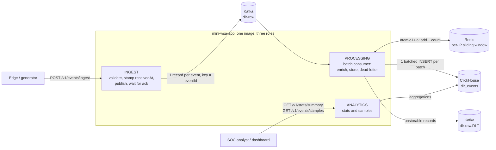

# Mini WSA: Security Analytics Pipeline

A small version of Akamai's Web Security Analytics. It ingests security events (DLRs), classifies and scores them, stores them in ClickHouse, and serves statistics and samples over a REST API. A generator produces realistic traffic, including attack waves.

```
POST /v1/events/ingest ──► Kafka ──► enrich (attack type, threat score, repeat-offender window in Redis) ──► ClickHouse
GET  /v1/stats/summary ◄──────────────────────────────────────────────────────────────────────────────────────┤
GET  /v1/events/samples ◄─────────────────────────────────────────────────────────────────────────────────────┘
```

- **Stack:** Java 25, Spring Boot 4.1, Kafka (KRaft), Redis, ClickHouse, Docker Compose, Testcontainers
- **Modules:** `mini-wsa-app` (the service) and `mini-wsa-generator` (load generator CLI)

## Contents
1. [Quick start](#quick-start)
2. [Architecture](#architecture)
3. [Storage choice](#storage-choice-clickhouse)
4. [Build, test and run](#build-test-and-run)
5. [API reference](#api-reference)

## Quick start

Requires Docker with Compose v2.

```bash
docker compose up -d --build --wait                 # Kafka, Redis, ClickHouse and the app on :8080
docker compose run --rm generator --count 10000     # 10k events, 30% in attack waves
curl -s localhost:8080/v1/stats/summary | jq
curl -s 'localhost:8080/v1/events/samples?category=INJECTION&limit=5' | jq
```

If port 8080 is busy, run `APP_PORT=18080 docker compose up -d --build --wait` and use that port.

Ingested events become queryable after a short delay, usually under 2 seconds (see [Consistency model](#consistency-model)).

## Architecture



### Request path
1. **Ingest** (`POST /v1/events/ingest`) accepts one event or an array. Validation is all-or-nothing: any invalid event rejects the batch with an itemized 400. Valid events get a server-side `receivedAt` and are published to Kafka, one record per event, keyed by `eventId`. The API answers **201 only after Kafka acknowledged every record** (`acks=all`), so a 201 means the data is stored durably.
2. **Processing** consumes batches of up to 1,000 records:
   - It sorts each batch by event time.
   - It records every event in a per-client-IP sliding window in Redis and counts that IP's earlier events in the 10 minutes before the event. One atomic Lua script per event does this, and all scripts of a batch go in one pipelined round trip.
   - It computes `attackType` and `threatScore`.
   - It writes the batch to ClickHouse with a single INSERT.
   - It sends records that cannot be stored to a dead-letter topic.
   - Only after all of that does it commit Kafka offsets.
3. **Analytics** answers `GET /v1/stats/summary` and `GET /v1/events/samples` directly from ClickHouse.

### Why a queue between ingest and storage
Attack bursts are exactly when DLR volume spikes. Kafka absorbs those spikes, so a slow or restarting database never blocks HTTP threads or loses data: consumers just fall behind and catch up. It also separates write throughput from query load.

### Failure handling in one sentence
Every processing step is idempotent, so on any failure the whole batch is simply processed again:
- The Redis window ignores eventIds it already holds.
- ClickHouse collapses re-inserted rows (`ReplacingMergeTree`).
- Offsets are committed last.

### Roles: one image, three jobs
`miniwsa.roles` (env `MINIWSA_ROLES`, default `ingest, processing, analytics`) decides which components a process creates. Locally and in the default compose, one container runs all three. In production, the same image can run as separately scaled services, e.g. 3 ingest, 2 processing, 1 analytics; see [Roles and split deployment](#roles-and-split-deployment). Health checks follow the roles: an ingest-only instance does not check ClickHouse or Redis.

### Code layout (`mini-wsa-app`)
| Package | Contents |
|---|---|
| `ingest` | Controller, payload parser, validator, size filter, Kafka publisher |
| `processing` | Batch consumer, enrichment, attack-type classifier, threat-score calculator, Redis window, dead-letter publisher, metrics |
| `storage` | Repository interfaces (`EnrichedEventWriter`, `EventAnalyticsReader`) and their ClickHouse implementations, schema |
| `analytics` | Stats and samples controllers/services, cursor paging |
| `domain` | Immutable records and enums (scores and labels live on the enums) |
| `api` | Response DTOs, RFC 9457 error handling |
| `config` | Roles, clock, role-based health defaults |

## Storage choice: ClickHouse

The workload is append-only, high-volume writes plus aggregation-heavy reads (counts, averages and top-N over time ranges), the classic OLAP shape. ClickHouse is a columnar store built for it:

- **Aggregations read only the columns they need**, compressed, vectorized. Counting by category over a billion rows touches a few bytes per row.
- **High insert throughput** with large batched inserts, which is exactly what the Kafka consumer produces.
- **Native features this design relies on:** `ReplacingMergeTree` for idempotent writes, `GROUPING SETS` for consistent multi-level aggregates, partition pruning, `Enum8` and `LowCardinality` encodings.

Alternatives considered:

| Option | Why not |
|---|---|
| PostgreSQL / MySQL | Row stores: aggregations scan whole rows, and indexes slow down the heavy write path. Fine at small scale, not at "millions of DLRs". |
| Elasticsearch / OpenSearch | Good for search and samples, but aggregations at this volume cost far more memory and disk. Ingestion is heavier. |
| Druid / Pinot | Strong real-time OLAP, but much heavier to operate for this scope. ClickHouse gives similar query performance with one container. |
| Cassandra | Excellent writes, but no ad-hoc aggregations. Every stat would need its own pre-built table. |

### Table design (`mini-wsa-app/src/main/resources/clickhouse/schema.sql`)
```sql
ENGINE = ReplacingMergeTree(received_at)
PARTITION BY toYYYYMMDD(timestamp)
ORDER BY (config_id, timestamp, event_id)
```
- **`ORDER BY (config_id, timestamp, …)`:** the typical query is one customer configuration over a time range. With `config_id` first, ClickHouse reads only that configuration's rows. Timestamp-first would read every configuration's rows in the range: about 1,000× more data with 1,000 configurations.
- **Daily partitions** prune time ranges when `configId` is omitted. Duplicates of an event share its timestamp, so they always land in the same partition, which lets them merge.
- **`event_id` last** makes the key unique per event. `ReplacingMergeTree` uses it to collapse re-deliveries and client retries.
- **`Enum8`** (category, action, severity) and **`LowCardinality(String)`** (policy, host, method, geo, attack type) keep repeated values tiny. Optional fields are `Nullable`.
- **No skip indexes:** no API filters by IP or path (they are only grouped by), and category/action are too dense to skip any granule.

### Why not JPA
JPA/Hibernate assumes transactions, row-by-row writes and mutable entities. ClickHouse has none of these, and it penalizes small inserts (`TOO_MANY_PARTS`). Persistence therefore goes through capability-named repository interfaces implemented with Spring `JdbcClient`/`JdbcTemplate`, and all SQL and ClickHouse settings stay inside the `storage` package. The project's `CLAUDE.md` was amended accordingly.

## Build, test and run

### Prerequisites
- Java 25 and Maven 3.8+ (the build uses the Spring Boot 4.1 parent)
- Docker: the integration tests use Testcontainers, and the stack runs with Compose

### Build and test
```bash
mvn clean verify
```
This runs about 210 tests:
- unit tests: classification, scoring, validation, the Redis window, row mapping, cursor paging, the generator
- integration tests with real Kafka, Redis and ClickHouse containers, including an end-to-end test through the REST API

### Run with Docker Compose
```bash
docker compose up -d --build --wait       # infrastructure + app (all roles) on :${APP_PORT:-8080}
docker compose logs -f app
docker compose down                        # stop; data is kept in named volumes
docker compose down -v                     # stop and delete all data
```
Defaults (ports, credentials, partitions, replicas) live in [`.env`](.env).

### Run the app from the IDE or Maven
```bash
docker compose up -d kafka kafka-init redis clickhouse --wait
CLICKHOUSE_USER=miniwsa CLICKHOUSE_PASSWORD=miniwsa mvn -pl mini-wsa-app spring-boot:run
```
The app connects to `localhost:9092`, `localhost:6379` and `localhost:8123` by default. Every setting can be overridden with environment variables.

### Generator
```bash
mvn -pl mini-wsa-generator package -DskipTests
java -jar mini-wsa-generator/target/mini-wsa-generator-0.1.0-SNAPSHOT.jar --count 10000 --seed 42
java -jar mini-wsa-generator/target/mini-wsa-generator-0.1.0-SNAPSHOT.jar --count 5000 --out build/events   # files only
java -jar mini-wsa-generator/target/mini-wsa-generator-0.1.0-SNAPSHOT.jar --help
```
Or inside Compose (targets the app container): `docker compose run --rm generator --count 10000`.

What it generates:
- **Background traffic:** weighted categories, each with matching rules, paths and severities; actions that follow severity; status codes that match the action (403, or 429 for rate limits); browser and tool user agents; geolocation.
- **Attack waves:** one IP hitting one path with one attack category, 20–200 events spaced 0.2–3 s apart. Waves are what trigger the repeat-offender bonus.

A fixed `--seed` reproduces the same data. `--out` writes `batch-NNNNN.json` files that can each be POSTed as-is.

| Option | Default | Meaning |
|---|---|---|
| `--url` | `http://localhost:8080` | API base URL |
| `--count` | 10000 | Number of events |
| `--batch-size` | 500 | Events per request or file (API limit 1000) |
| `--wave-ratio` | 0.3 | Share of events in attack waves |
| `--wave-size-min` / `--wave-size-max` | 20 / 200 | Events per wave |
| `--start` / `--duration` | now − 1h / `1h` | Event-time range (`PT2H`, `90m`, …) |
| `--seed` | random | Reproducible output |
| `--concurrency` | 4 | Parallel POSTs |
| `--out` | (none) | Write files instead of POSTing |

## API reference

Base URL: `http://localhost:8080`. Errors use [RFC 9457](https://www.rfc-editor.org/rfc/rfc9457) problem details (`application/problem+json`).

| Status | When |
|---|---|
| 201 | Ingest batch durably accepted (Kafka acknowledged every event) |
| 200 | Stats / samples |
| 400 | Invalid JSON, invalid event(s) (batch rejected, itemized `errors`), invalid query parameters, `from` after `to` |
| 413 | Body over 5 MB (checked before parsing) or more than 1000 events |
| 503 | Kafka (ingest) or ClickHouse (analytics) unavailable; retry after the `Retry-After` seconds |

### `POST /v1/events/ingest`
Accepts one event object or an array of up to 1000 events. Everything is validated before anything is published, and one invalid event rejects the whole batch. On success every event gets the same server-side `receivedAt`.

```bash
curl -i -X POST localhost:8080/v1/events/ingest -H 'Content-Type: application/json' -d '{
  "eventId": "evt-00132",
  "timestamp": "2026-05-20T14:32:10Z",
  "configId": 14227,
  "policyId": "pol_web1",
  "clientIp": "203.0.113.42",
  "hostname": "www.example.com",
  "path": "/api/v1/login",
  "method": "POST",
  "statusCode": 403,
  "userAgent": "Mozilla/5.0 (Windows NT 10.0; Win64; x64)",
  "rule": {"id": "950001", "name": "SQL_INJECTION", "message": "SQL Injection Attack Detected",
           "severity": "CRITICAL", "category": "INJECTION"},
  "action": "DENY",
  "geoLocation": {"country": "CN", "city": "Beijing"},
  "requestSize": 1024,
  "responseSize": 256
}'
```
```http
HTTP/1.1 201
{"accepted":1,"receivedAt":"2026-10-24T13:05:11.204Z"}
```
For a batch, send a JSON array of such objects, or a file written by the generator: `curl ... -d @build/events/batch-00001.json`.

**Validation rules**

| Field(s) | Rule |
|---|---|
| `eventId`, `policyId`, `clientIp`, `hostname`, `path`, `method`, `rule.id`, `rule.name` | Required, non-blank, with length limits |
| `timestamp` | Required, ISO-8601 instant, at most 5 minutes ahead of server time (`miniwsa.ingest.max-future-skew`) |
| `configId` | Required, positive |
| `clientIp` | IPv4 dotted quad or IPv6 literal |
| `statusCode` | Required, 100–599 |
| `rule.severity` | `CRITICAL`, `HIGH`, `MEDIUM`, `LOW` |
| `rule.category` | `INJECTION`, `XSS`, `PROTOCOL_VIOLATION`, `DATA_LEAKAGE`, `BOT`, `DOS`, `RATE_LIMIT` |
| `action` | `DENY`, `ALERT`, `MONITOR` |
| `userAgent`, `rule.message`, `geoLocation`, `requestSize`, `responseSize` | Optional; sizes must not be negative |

Unknown fields are ignored. For each event, every constraint violation is reported. A value that cannot be parsed at all (wrong type, unknown enum value, malformed timestamp) is reported as the first such problem of that event.

```bash
# second event has an unknown category
curl -s -X POST localhost:8080/v1/events/ingest -H 'Content-Type: application/json' -d '[{...valid...}, {...,"rule":{...,"category":"SQLI"}}]'
```
```json
{
  "title": "Bad Request",
  "status": 400,
  "detail": "1 validation error(s); batch rejected",
  "instance": "/v1/events/ingest",
  "errors": [
    {"index": 1, "field": "rule.category",
     "message": "must be one of [INJECTION, XSS, PROTOCOL_VIOLATION, DATA_LEAKAGE, BOT, DOS, RATE_LIMIT]"}
  ]
}
```
```json
{"title": "Content Too Large", "status": 413, "instance": "/v1/events/ingest",
 "detail": "batch of 1001 events exceeds the limit of 1000; split it into smaller requests"}
```

**Enrichment** (applied by processing):
- `attackType` is a label per category:

  | Category | Attack type |
  |---|---|
  | INJECTION | SQL/Command Injection |
  | XSS | Cross-Site Scripting |
  | PROTOCOL_VIOLATION | Protocol Anomaly |
  | DATA_LEAKAGE | Data Exfiltration |
  | BOT | Bot Activity |
  | DOS | Denial of Service |
  | RATE_LIMIT | Rate Limiting |

- `threatScore` is the sum of the following, capped at 100:
  - severity: CRITICAL 40, HIGH 30, MEDIUM 20, LOW 10
  - action: DENY 20, ALERT 10, MONITOR 0
  - +15 if the path contains `/admin` or `/login`
  - +15 if more than 5 earlier events from the same `clientIp` fall in the 10 minutes before the event

  See [Scoring details](#scoring-details) for the exact rules.

### `GET /v1/stats/summary?configId=&from=&to=`
All parameters are optional. `from`/`to` are inclusive ISO-8601 instants and filter on the event `timestamp`. Without `configId`, statistics cover all configurations.

```bash
curl -s 'localhost:8080/v1/stats/summary?configId=14227&from=2026-05-20T00:00:00Z&to=2026-05-21T00:00:00Z'
```
```json
{
  "configId": 14227,
  "timeRange": {"from": "2026-05-20T00:00:00Z", "to": "2026-05-21T00:00:00Z"},
  "totalEvents": 1523,
  "byCategory": {
    "INJECTION": {"count": 450, "avgThreatScore": 72.3},
    "XSS": {"count": 213, "avgThreatScore": 51.0},
    "PROTOCOL_VIOLATION": {"count": 0, "avgThreatScore": 0.0},
    "...": "..."
  },
  "byAction": {"DENY": 890, "ALERT": 433, "MONITOR": 200},
  "topAttackers": [{"clientIp": "203.0.113.42", "count": 87, "avgThreatScore": 81.2}],
  "topTargetedPaths": [{"path": "/api/v1/login", "count": 234}]
}
```
- `byCategory` and `byAction` always list every category and action, zero-filled, and always add up to `totalEvents`: all three come from one `GROUPING SETS` query.
- `topAttackers` and `topTargetedPaths` hold the top 10 by event count, ties broken by IP or path ascending, so results are stable.
- Averages are rounded to one decimal.

### `GET /v1/events/samples?configId=&from=&to=&category=&action=&limit=&offset=`
Returns individual enriched events, newest first (event `timestamp` descending, ties by `eventId` descending). All filters are optional; `limit` defaults to 20 (1–100) and `offset` to 0. Each event has the original DLR fields plus `receivedAt`, `attackType` and `threatScore`.

```bash
curl -si 'localhost:8080/v1/events/samples?configId=14227&category=INJECTION&action=DENY&limit=2'
```
```http
HTTP/1.1 200
Link: <http://localhost:8080/v1/events/samples?configId=14227&category=INJECTION&action=DENY&limit=2&to=2026-05-20T14:32:09Z&offset=1>; rel="next"

{
  "total": 450,
  "limit": 2,
  "offset": 0,
  "events": [
    {"eventId": "evt-00133", "timestamp": "2026-05-20T14:32:11Z", "configId": 14227, "...": "...",
     "receivedAt": "2026-05-20T14:32:13.020Z", "attackType": "SQL/Command Injection", "threatScore": 90},
    {"eventId": "evt-00132", "timestamp": "2026-05-20T14:32:09Z", "configId": 14227, "...": "...",
     "receivedAt": "2026-05-20T14:32:12.511Z", "attackType": "SQL/Command Injection", "threatScore": 75}
  ]
}
```
`total` counts every event matching the filters, regardless of `limit`/`offset`.

#### Paging while events keep arriving: the `Link` header

Results are newest first and new events arrive all the time, so plain offset paging shifts between requests (5 new events arrive → page 2 repeats 5 events of page 1). The fix needs no new parameter: **`to` and `offset` together act as a cursor**, and every page except the last carries a `Link: <…>; rel="next"` header with the correct next request. Clients just follow it. Clients that do their own offset paging should at least pin `to` on the first request.

Worked example with `limit=5`, using this data sorted the way the server sorts it:

| # | timestamp | eventId |
|---|---|---|
| 1 | 10:00:07.000 | evt-120 |
| 2 | 10:00:06.500 | evt-119 |
| 3 | 10:00:05.120 | evt-118 |
| 4 | 10:00:05.120 | evt-117 |
| 5 | 10:00:05.120 | evt-116 |
| 6 | 10:00:05.120 | evt-115 |
| 7 | 10:00:04.900 | evt-114 |
| 8 | 10:00:03.000 | evt-113 |

Four events share `10:00:05.120` (common in attack bursts), and the page boundary falls in the middle of them.

**Page 1.** The client sends `GET /v1/events/samples?limit=5`. The server runs
`… ORDER BY timestamp DESC, event_id DESC LIMIT 5 OFFSET 0` and returns rows 1–5. It computes the cursor from the page itself:
- `to` = timestamp of the last returned event = `10:00:05.120`
- `offset` = how many returned events have that same timestamp: evt-118, evt-117 and evt-116 = **3**

```
Link: </v1/events/samples?limit=5&to=2026-05-20T10:00:05.120Z&offset=3>; rel="next"
```

**Meanwhile** `evt-121` arrives with timestamp `10:00:08.000`, which would be the new row 1.

**Page 2.** The client follows the link. `to` is inclusive, so the server runs
`… WHERE timestamp <= '10:00:05.120' ORDER BY timestamp DESC, event_id DESC LIMIT 5 OFFSET 3`:
```
evt-118, evt-117, evt-116,   evt-115, evt-114, evt-113, …
└─ skipped (offset 3) ─┘     └─ returned ─────────────
```
Page 2 starts exactly where page 1 ended: nothing repeated, nothing skipped. `evt-121` is newer than `to`, so it cannot shift anything. With naive `offset=5` the client would get `evt-116` again, a duplicate.

**When a whole page shares the timestamp**, the skip count adds up. Say 12 events share `10:00:05.120`: page 2 (`to=…05.120, offset=3`) returns 5 more of them, so page 3 must skip 3 + 5:
```
next.to     = timestamp of the last event on this page
next.offset = (next.to == current.to ? current.offset : 0) + events on this page with timestamp == next.to
```
That gives page 3 `to=…05.120&offset=8`. The server applies this rule when it builds the `Link` header, so clients never need to.

| | Client | Server |
|---|---|---|
| First page | `GET …?limit=20` (+ filters) | Query with the tie-break order; return page, `total` and `Link: rel="next"` |
| Next pages | Follow the `Link` URL as-is | Same query; the inclusive `to` acts as the cursor, `offset` skips ties already sent |
| Last page | No `Link` header: done | `Link` omitted when the page has fewer than `limit` events |

Caveats:
- On later pages, `total` counts events up to the cursor's `to`. Keep the total from the first page.
- A *late* event carrying exactly the boundary millisecond, arriving between two page requests, can still shift the tied events by one.
- Deep offsets stay cheap: `offset` only ever counts the tied events, not everything before the page.
