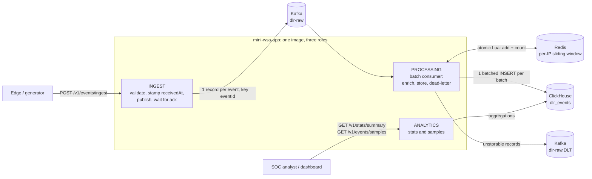

# Mini WSA: Security Analytics Pipeline

A small version of Akamai's Web Security Analytics. It ingests security events (DLRs), classifies and scores them, stores them in ClickHouse, and serves statistics and samples over a REST API. A generator produces realistic traffic, including attack waves.

```
POST /v1/events/ingest ──► Kafka ──► enrich (attack type, threat score, repeat-offender window in Redis) ──► ClickHouse
GET  /v1/stats/summary ◄──────────────────────────────────────────────────────────────────────────────────────┤
GET  /v1/events/samples ◄─────────────────────────────────────────────────────────────────────────────────────┘
```

- **Stack:** Java 25, Spring Boot 4.1, Kafka (KRaft), Redis, ClickHouse, Docker Compose, Testcontainers
- **Modules:** `mini-wsa-app` (the service) and `mini-wsa-generator` (load generator CLI)

## Contents
1. [Quick start](#quick-start)
2. [Architecture](#architecture)
3. [Storage choice](#storage-choice-clickhouse)
4. [Build, test and run](#build-test-and-run)
5. [API reference](#api-reference)
6. [Operations guide](#operations-guide)
7. [Design decisions and trade-offs](#design-decisions-and-trade-offs)
8. [Challenges and how they were solved](#challenges-and-how-they-were-solved)
9. [Future improvements](#future-improvements)
10. [Troubleshooting](#troubleshooting)
11. [Project history](#project-history)

## Quick start

Requires Docker with Compose v2.

```bash
docker compose up -d --build --wait                 # Kafka, Redis, ClickHouse, the two UIs and the app on :8080
docker compose run --rm generator --count 10000     # 10k events, 30% in attack waves
curl -s localhost:8080/v1/stats/summary | jq
curl -s 'localhost:8080/v1/events/samples?category=INJECTION&limit=5' | jq
```

| Page | URL |
|---|---|
| Swagger UI: interactive API docs with "Try it out" | http://localhost:8080/swagger-ui.html |
| OpenAPI spec (JSON) | http://localhost:8080/v3/api-docs |
| Kafka UI: topics, messages with headers, consumer lag | http://localhost:8090 |
| CH-UI: ClickHouse table browser and SQL editor (log in as `miniwsa` / `miniwsa`) | http://localhost:3488 |
| ClickHouse built-in SQL console / server dashboard (same credentials) | http://localhost:8123/play · http://localhost:8123/dashboard |

If port 8080 is busy, run `APP_PORT=18080 docker compose up -d --build --wait` and use that port.

Ingested events become queryable after a short delay, usually under 2 seconds (see [Consistency model](#consistency-model)).

## Architecture



### Request path
1. **Ingest** (`POST /v1/events/ingest`) accepts one event or an array. Validation is all-or-nothing: any invalid event rejects the batch with an itemized 400. Valid events get a server-side `receivedAt` and are published to Kafka, one record per event, keyed by `eventId`. The API answers **201 only after Kafka acknowledged every record** (`acks=all`), so a 201 means the data is stored durably.
2. **Processing** consumes batches of up to 1,000 records:
   - It sorts each batch by event time.
   - It records every event in a per-client-IP sliding window in Redis and counts that IP's earlier events in the 10 minutes before the event. One atomic Lua script per event does this, and all scripts of a batch go in one pipelined round trip.
   - It computes `attackType` and `threatScore`.
   - It writes the batch to ClickHouse with a single INSERT.
   - It sends records that cannot be stored to a dead-letter topic.
   - Only after all of that does it commit Kafka offsets.
3. **Analytics** answers `GET /v1/stats/summary` and `GET /v1/events/samples` directly from ClickHouse.

### Why a queue between ingest and storage
Attack bursts are exactly when DLR volume spikes. Kafka absorbs those spikes, so a slow or restarting database never blocks HTTP threads or loses data: consumers just fall behind and catch up. It also separates write throughput from query load.

### Failure handling in one sentence
Every processing step is idempotent, so on any failure the whole batch is simply processed again:
- The Redis window ignores eventIds it already holds.
- ClickHouse collapses re-inserted rows (`ReplacingMergeTree`).
- Offsets are committed last.

### Roles: one image, three jobs
`miniwsa.roles` (env `MINIWSA_ROLES`, default `ingest, processing, analytics`) decides which components a process creates. Locally and in the default compose, one container runs all three. In production, the same image can run as separately scaled services, e.g. 3 ingest, 2 processing, 1 analytics; see [Roles and split deployment](#roles-and-split-deployment). Health checks follow the roles: an ingest-only instance does not check ClickHouse or Redis.

### Code layout (`mini-wsa-app`)
| Package | Contents |
|---|---|
| `ingest` | Controller, payload parser, validator, size filter, Kafka publisher |
| `processing` | Batch consumer, enrichment, attack-type classifier, threat-score calculator, Redis window, dead-letter publisher, metrics |
| `storage` | Repository interfaces (`EnrichedEventWriter`, `EventAnalyticsReader`) and their ClickHouse implementations, schema |
| `analytics` | Stats and samples controllers/services, cursor paging |
| `domain` | Immutable records and enums (scores and labels live on the enums) |
| `api` | Response DTOs, RFC 9457 error handling |
| `config` | Roles, clock, role-based health defaults |

## Storage choice: ClickHouse

The workload is append-only, high-volume writes plus aggregation-heavy reads (counts, averages and top-N over time ranges), the classic OLAP shape. ClickHouse is a columnar store built for it:

- **Aggregations read only the columns they need**, compressed, vectorized. Counting by category over a billion rows touches a few bytes per row.
- **High insert throughput** with large batched inserts, which is exactly what the Kafka consumer produces.
- **Native features this design relies on:** `ReplacingMergeTree` for idempotent writes, `GROUPING SETS` for consistent multi-level aggregates, partition pruning, `Enum8` and `LowCardinality` encodings.

Alternatives considered:

| Option | Why not |
|---|---|
| PostgreSQL / MySQL | Row stores: aggregations scan whole rows, and indexes slow down the heavy write path. Fine at small scale, not at "millions of DLRs". |
| Elasticsearch / OpenSearch | Good for search and samples, but aggregations at this volume cost far more memory and disk. Ingestion is heavier. |
| Druid / Pinot | Strong real-time OLAP, but much heavier to operate for this scope. ClickHouse gives similar query performance with one container. |
| Cassandra | Excellent writes, but no ad-hoc aggregations. Every stat would need its own pre-built table. |

### Table design (`mini-wsa-app/src/main/resources/clickhouse/schema.sql`)
```sql
ENGINE = ReplacingMergeTree(received_at)
PARTITION BY toYYYYMMDD(timestamp)
ORDER BY (config_id, timestamp, event_id)
```
- **`ORDER BY (config_id, timestamp, …)`:** the typical query is one customer configuration over a time range. With `config_id` first, ClickHouse reads only that configuration's rows. Timestamp-first would read every configuration's rows in the range: about 1,000× more data with 1,000 configurations.
- **Daily partitions** prune time ranges when `configId` is omitted. Duplicates of an event share its timestamp, so they always land in the same partition, which lets them merge.
- **`event_id` last** makes the key unique per event. `ReplacingMergeTree` uses it to collapse re-deliveries and client retries.
- **`Enum8`** (category, action, severity) and **`LowCardinality(String)`** (policy, host, method, geo, attack type) keep repeated values tiny. Optional fields are `Nullable`.
- **No skip indexes:** no API filters by IP or path (they are only grouped by), and category/action are too dense to skip any granule.

### Why not JPA
JPA/Hibernate assumes transactions, row-by-row writes and mutable entities. ClickHouse has none of these, and it penalizes small inserts (`TOO_MANY_PARTS`). Persistence therefore goes through capability-named repository interfaces implemented with Spring `JdbcClient`/`JdbcTemplate`, and all SQL and ClickHouse settings stay inside the `storage` package. The project's `CLAUDE.md` was amended accordingly.

## Build, test and run

### Prerequisites
- Java 25 and Maven 3.8+ (the build uses the Spring Boot 4.1 parent)
- Docker: the integration tests use Testcontainers, and the stack runs with Compose

### Build and test
```bash
mvn clean verify
```
This runs about 210 tests:
- unit tests: classification, scoring, validation, the Redis window, row mapping, cursor paging, the generator
- integration tests with real Kafka, Redis and ClickHouse containers, including an end-to-end test through the REST API

### Run with Docker Compose
```bash
docker compose up -d --build --wait       # infrastructure + app (all roles) on :${APP_PORT:-8080}
docker compose logs -f app
docker compose down                        # stop; data is kept in named volumes
docker compose down -v                     # stop and delete all data
```
Defaults (ports, credentials, partitions, replicas) live in [`.env`](.env).

### Run the app from the IDE or Maven
```bash
docker compose up -d kafka kafka-init redis clickhouse --wait
CLICKHOUSE_USER=miniwsa CLICKHOUSE_PASSWORD=miniwsa mvn -pl mini-wsa-app spring-boot:run
```
The app connects to `localhost:9092`, `localhost:6379` and `localhost:8123` by default. Every setting can be overridden with environment variables.

### Generator
```bash
mvn -pl mini-wsa-generator package -DskipTests
java -jar mini-wsa-generator/target/mini-wsa-generator-0.1.0-SNAPSHOT.jar --count 10000 --seed 42
java -jar mini-wsa-generator/target/mini-wsa-generator-0.1.0-SNAPSHOT.jar --count 5000 --out build/events   # files only
java -jar mini-wsa-generator/target/mini-wsa-generator-0.1.0-SNAPSHOT.jar --help
```
Or inside Compose (targets the app container): `docker compose run --rm generator --count 10000`.

What it generates:
- **Background traffic:** weighted categories, each with matching rules, paths and severities; actions that follow severity; status codes that match the action (403, or 429 for rate limits); browser and tool user agents; geolocation.
- **Attack waves:** one IP hitting one path with one attack category, 20–200 events spaced 0.2–3 s apart. Waves are what trigger the repeat-offender bonus.

A fixed `--seed` reproduces the same data. `--out` writes `batch-NNNNN.json` files that can each be POSTed as-is.

| Option | Default | Meaning |
|---|---|---|
| `--url` | `http://localhost:8080` | API base URL |
| `--count` | 10000 | Number of events |
| `--batch-size` | 500 | Events per request or file (API limit 1000) |
| `--wave-ratio` | 0.3 | Share of events in attack waves |
| `--wave-size-min` / `--wave-size-max` | 20 / 200 | Events per wave |
| `--start` / `--duration` | now − 1h / `1h` | Event-time range (`PT2H`, `90m`, …) |
| `--seed` | random | Reproducible output |
| `--concurrency` | 4 | Parallel POSTs |
| `--out` | (none) | Write files instead of POSTing |

## API reference

Base URL: `http://localhost:8080`. The same API can be explored and called from **Swagger UI at http://localhost:8080/swagger-ui.html** (spec: `/v3/api-docs`). Each instance documents only the endpoints of its roles. In the split layout the gateway does not route the docs, so browse them in the default single-container layout. Errors use [RFC 9457](https://www.rfc-editor.org/rfc/rfc9457) problem details (`application/problem+json`).

| Status | When |
|---|---|
| 201 | Ingest batch durably accepted (Kafka acknowledged every event) |
| 200 | Stats / samples |
| 400 | Invalid JSON, invalid event(s) (batch rejected, itemized `errors`), invalid query parameters, `from` after `to` |
| 413 | Body over 5 MB (checked before parsing) or more than 1000 events |
| 503 | Kafka (ingest) or ClickHouse (analytics) unavailable; retry after the `Retry-After` seconds |

### `POST /v1/events/ingest`
Accepts one event object or an array of up to 1000 events. Everything is validated before anything is published, and one invalid event rejects the whole batch. On success every event gets the same server-side `receivedAt`.

```bash
curl -i -X POST localhost:8080/v1/events/ingest -H 'Content-Type: application/json' -d '{
  "eventId": "evt-00132",
  "timestamp": "2026-05-20T14:32:10Z",
  "configId": 14227,
  "policyId": "pol_web1",
  "clientIp": "203.0.113.42",
  "hostname": "www.example.com",
  "path": "/api/v1/login",
  "method": "POST",
  "statusCode": 403,
  "userAgent": "Mozilla/5.0 (Windows NT 10.0; Win64; x64)",
  "rule": {"id": "950001", "name": "SQL_INJECTION", "message": "SQL Injection Attack Detected",
           "severity": "CRITICAL", "category": "INJECTION"},
  "action": "DENY",
  "geoLocation": {"country": "CN", "city": "Beijing"},
  "requestSize": 1024,
  "responseSize": 256
}'
```
```http
HTTP/1.1 201
{"accepted":1,"receivedAt":"2026-10-24T13:05:11.204Z"}
```
For a batch, send a JSON array of such objects, or a file written by the generator: `curl ... -d @build/events/batch-00001.json`.

**Validation rules**

| Field(s) | Rule |
|---|---|
| `eventId`, `policyId`, `clientIp`, `hostname`, `path`, `method`, `rule.id`, `rule.name` | Required, non-blank, with length limits |
| `timestamp` | Required, ISO-8601 instant, at most 5 minutes ahead of server time (`miniwsa.ingest.max-future-skew`) |
| `configId` | Required, positive |
| `clientIp` | IPv4 dotted quad or IPv6 literal |
| `statusCode` | Required, 100–599 |
| `rule.severity` | `CRITICAL`, `HIGH`, `MEDIUM`, `LOW` |
| `rule.category` | `INJECTION`, `XSS`, `PROTOCOL_VIOLATION`, `DATA_LEAKAGE`, `BOT`, `DOS`, `RATE_LIMIT` |
| `action` | `DENY`, `ALERT`, `MONITOR` |
| `userAgent`, `rule.message`, `geoLocation`, `requestSize`, `responseSize` | Optional; sizes must not be negative |

Unknown fields are ignored. For each event, every constraint violation is reported. A value that cannot be parsed at all (wrong type, unknown enum value, malformed timestamp) is reported as the first such problem of that event.

```bash
# second event has an unknown category
curl -s -X POST localhost:8080/v1/events/ingest -H 'Content-Type: application/json' -d '[{...valid...}, {...,"rule":{...,"category":"SQLI"}}]'
```
```json
{
  "title": "Bad Request",
  "status": 400,
  "detail": "1 validation error(s); batch rejected",
  "instance": "/v1/events/ingest",
  "errors": [
    {"index": 1, "field": "rule.category",
     "message": "must be one of [INJECTION, XSS, PROTOCOL_VIOLATION, DATA_LEAKAGE, BOT, DOS, RATE_LIMIT]"}
  ]
}
```
```json
{"title": "Content Too Large", "status": 413, "instance": "/v1/events/ingest",
 "detail": "batch of 1001 events exceeds the limit of 1000; split it into smaller requests"}
```

**Enrichment** (applied by processing):
- `attackType` is a label per category:

  | Category | Attack type |
  |---|---|
  | INJECTION | SQL/Command Injection |
  | XSS | Cross-Site Scripting |
  | PROTOCOL_VIOLATION | Protocol Anomaly |
  | DATA_LEAKAGE | Data Exfiltration |
  | BOT | Bot Activity |
  | DOS | Denial of Service |
  | RATE_LIMIT | Rate Limiting |

- `threatScore` is the sum of the following, capped at 100:
  - severity: CRITICAL 40, HIGH 30, MEDIUM 20, LOW 10
  - action: DENY 20, ALERT 10, MONITOR 0
  - +15 if the path contains `/admin` or `/login`
  - +15 if more than 5 earlier events from the same `clientIp` fall in the 10 minutes before the event

  See [Scoring details](#scoring-details) for the exact rules.

### `GET /v1/stats/summary?configId=&from=&to=`
All parameters are optional. `from`/`to` are inclusive ISO-8601 instants and filter on the event `timestamp`. Without `configId`, statistics cover all configurations.

```bash
curl -s 'localhost:8080/v1/stats/summary?configId=14227&from=2026-05-20T00:00:00Z&to=2026-05-21T00:00:00Z'
```
```json
{
  "configId": 14227,
  "timeRange": {"from": "2026-05-20T00:00:00Z", "to": "2026-05-21T00:00:00Z"},
  "totalEvents": 1523,
  "byCategory": {
    "INJECTION": {"count": 450, "avgThreatScore": 72.3},
    "XSS": {"count": 213, "avgThreatScore": 51.0},
    "PROTOCOL_VIOLATION": {"count": 0, "avgThreatScore": 0.0},
    "...": "..."
  },
  "byAction": {"DENY": 890, "ALERT": 433, "MONITOR": 200},
  "topAttackers": [{"clientIp": "203.0.113.42", "count": 87, "avgThreatScore": 81.2}],
  "topTargetedPaths": [{"path": "/api/v1/login", "count": 234}]
}
```
- `byCategory` and `byAction` always list every category and action, zero-filled, and always add up to `totalEvents`: all three come from one `GROUPING SETS` query.
- `topAttackers` and `topTargetedPaths` hold the top 10 by event count, ties broken by IP or path ascending, so results are stable.
- Averages are rounded to one decimal.

### `GET /v1/events/samples?configId=&from=&to=&category=&action=&limit=&offset=`
Returns individual enriched events, newest first (event `timestamp` descending, ties by `eventId` descending). All filters are optional; `limit` defaults to 20 (1–100) and `offset` to 0. Each event has the original DLR fields plus `receivedAt`, `attackType` and `threatScore`.

```bash
curl -si 'localhost:8080/v1/events/samples?configId=14227&category=INJECTION&action=DENY&limit=2'
```
```http
HTTP/1.1 200
Link: <http://localhost:8080/v1/events/samples?configId=14227&category=INJECTION&action=DENY&limit=2&to=2026-05-20T14:32:09Z&offset=1>; rel="next"

{
  "total": 450,
  "limit": 2,
  "offset": 0,
  "events": [
    {"eventId": "evt-00133", "timestamp": "2026-05-20T14:32:11Z", "configId": 14227, "...": "...",
     "receivedAt": "2026-05-20T14:32:13.020Z", "attackType": "SQL/Command Injection", "threatScore": 90},
    {"eventId": "evt-00132", "timestamp": "2026-05-20T14:32:09Z", "configId": 14227, "...": "...",
     "receivedAt": "2026-05-20T14:32:12.511Z", "attackType": "SQL/Command Injection", "threatScore": 75}
  ]
}
```
`total` counts every event matching the filters, regardless of `limit`/`offset`.

#### Paging while events keep arriving: the `Link` header

Results are newest first and new events arrive all the time, so plain offset paging shifts between requests (5 new events arrive → page 2 repeats 5 events of page 1). The fix needs no new parameter: **`to` and `offset` together act as a cursor**, and every page except the last carries a `Link: <…>; rel="next"` header with the correct next request. Clients just follow it. Clients that do their own offset paging should at least pin `to` on the first request.

Worked example with `limit=5`, using this data sorted the way the server sorts it:

| # | timestamp | eventId |
|---|---|---|
| 1 | 10:00:07.000 | evt-120 |
| 2 | 10:00:06.500 | evt-119 |
| 3 | 10:00:05.120 | evt-118 |
| 4 | 10:00:05.120 | evt-117 |
| 5 | 10:00:05.120 | evt-116 |
| 6 | 10:00:05.120 | evt-115 |
| 7 | 10:00:04.900 | evt-114 |
| 8 | 10:00:03.000 | evt-113 |

Four events share `10:00:05.120` (common in attack bursts), and the page boundary falls in the middle of them.

**Page 1.** The client sends `GET /v1/events/samples?limit=5`. The server runs
`… ORDER BY timestamp DESC, event_id DESC LIMIT 5 OFFSET 0` and returns rows 1–5. It computes the cursor from the page itself:
- `to` = timestamp of the last returned event = `10:00:05.120`
- `offset` = how many returned events have that same timestamp: evt-118, evt-117 and evt-116 = **3**

```
Link: </v1/events/samples?limit=5&to=2026-05-20T10:00:05.120Z&offset=3>; rel="next"
```

**Meanwhile** `evt-121` arrives with timestamp `10:00:08.000`, which would be the new row 1.

**Page 2.** The client follows the link. `to` is inclusive, so the server runs
`… WHERE timestamp <= '10:00:05.120' ORDER BY timestamp DESC, event_id DESC LIMIT 5 OFFSET 3`:
```
evt-118, evt-117, evt-116,   evt-115, evt-114, evt-113, …
└─ skipped (offset 3) ─┘     └─ returned ─────────────
```
Page 2 starts exactly where page 1 ended: nothing repeated, nothing skipped. `evt-121` is newer than `to`, so it cannot shift anything. With naive `offset=5` the client would get `evt-116` again, a duplicate.

**When a whole page shares the timestamp**, the skip count adds up. Say 12 events share `10:00:05.120`: page 2 (`to=…05.120, offset=3`) returns 5 more of them, so page 3 must skip 3 + 5:
```
next.to     = timestamp of the last event on this page
next.offset = (next.to == current.to ? current.offset : 0) + events on this page with timestamp == next.to
```
That gives page 3 `to=…05.120&offset=8`. The server applies this rule when it builds the `Link` header, so clients never need to.

| | Client | Server |
|---|---|---|
| First page | `GET …?limit=20` (+ filters) | Query with the tie-break order; return page, `total` and `Link: rel="next"` |
| Next pages | Follow the `Link` URL as-is | Same query; the inclusive `to` acts as the cursor, `offset` skips ties already sent |
| Last page | No `Link` header: done | `Link` omitted when the page has fewer than `limit` events |

Caveats:
- On later pages, `total` counts events up to the cursor's `to`. Keep the total from the first page.
- A *late* event carrying exactly the boundary millisecond, arriving between two page requests, can still shift the tied events by one.
- Deep offsets stay cheap: `offset` only ever counts the tied events, not everything before the page.

## Operations guide

### Consistency model
- **201 means "durably accepted", not "queryable yet".** After the 201, an event still goes through the consumer, Redis and the ClickHouse insert. Normally that takes well under 2 s (measured: p99 below 1 s on a laptop). During bursts the consumers fall behind, and the delay grows until they catch up. Kafka holds the data meanwhile; nothing is dropped.
- **Watching the delay.** `/actuator/metrics/miniwsa.processing.lag` measures the time from ingestion to storage. `kafka.consumer.fetch.manager.records.lag.max` is the number of records not yet consumed. `miniwsa.delivery.lag` measures how late events reach us (`receivedAt − timestamp`).
- **Within one stats response**, `totalEvents`, `byCategory` and `byAction` come from a single read and always add up. The top-10 lists are separate parallel queries, so they may include events stored a few milliseconds later.
- Tests never sleep; they poll until data shows up (Awaitility).

**Consumer settings** (`spring.kafka.consumer.*`, overridable via environment variables). A batch is handed to processing when it is full **or** when the wait expires, whichever comes first:

| Setting | Default | Effect |
|---|---|---|
| `max-poll-records` | 1000 | Batch size, which is also the ClickHouse INSERT size. Larger batches mean fewer, bigger ClickHouse parts (cheaper merges) and more work redone after a crash. |
| `fetch-max-wait` | 500ms | Longest a quiet partition waits to fill a batch. This caps the delay when traffic is light. |
| `fetch-min-size` | 64KB | Bytes the broker gathers before answering early. Higher values give bigger batches under load. |
| `miniwsa.processing.concurrency` | 3 | Consumer threads per instance. Useful up to the number of partitions (6 in compose). |

Alternative profiles:
- **Low latency:** `max-poll-records=500`, `fetch-max-wait=100ms`. Events are visible faster, at the cost of more and smaller inserts.
- **High throughput:** `max-poll-records=5000`, `fetch-max-wait=2s`. Fewer, larger inserts that ClickHouse handles very well; events take a few seconds longer to appear.

### Query accuracy: `miniwsa.analytics.accuracy`
Kafka delivers at least once: a crash or rebalance between the INSERT and the offset commit, or a client retrying after a lost 201, stores an event twice. `ReplacingMergeTree` removes the duplicate during background merges, but those happen later.

| Value | Behaviour |
|---|---|
| `EXACT` (default) | Reads use `FINAL` (with `do_not_merge_across_partitions_select_final=1`), so duplicates are removed at read time. Results are always exact; reads cost about 1.2–2× more. |
| `BEST_EFFORT` | No `FINAL`. Faster, but counts can be inflated briefly after crashes, rebalances or client retries, until merges catch up. |

This is a deployment setting (`MINIWSA_ANALYTICS_ACCURACY`), not an API parameter. Example: an investigation instance can run `EXACT` while a high-traffic wall dashboard runs `BEST_EFFORT`. In testing, re-consuming a whole topic from a new consumer group left 18,091 raw rows; `EXACT` returned exactly the 15,309 unique events.

### Roles and split deployment
`miniwsa.roles` decides what a process runs. It binds to an enum, so a typo or an empty value fails at startup.

| Role | Runs | Needs |
|---|---|---|
| `ingest` | `POST /v1/events/ingest`, size filter, Kafka producer | Kafka |
| `processing` | Kafka listener, enrichment, Redis window, ClickHouse writer, dead-letter publisher | Kafka, Redis, ClickHouse |
| `analytics` | Stats and samples endpoints | ClickHouse |

The default compose runs one container with all roles. `docker-compose.split.yml` runs the same image as separate services behind an nginx gateway that routes by path, so clients still see one URL:
```bash
docker compose -f docker-compose.yml -f docker-compose.split.yml up -d --build --wait
docker compose -f docker-compose.yml -f docker-compose.split.yml run --rm generator --count 10000
```
- **Replica counts** come from `.env`: `INGEST_REPLICAS=3`, `PROCESSING_REPLICAS=2`, `ANALYTICS_REPLICAS=1`.
- **Processing replicas** share one consumer group, so Kafka spreads the 6 partitions over 2 replicas × 3 threads. More threads than partitions would sit idle.
- **The gateway** re-resolves service names every 5 s, so recreated or scaled replicas are picked up.
- **Why separate roles:** the write path is high-volume and must never stall, while heavy dashboard queries cost memory and garbage-collection pauses. Separate processes keep one from starving the other. The whole split layout needs about 5–6 GB of RAM.

### Kafka UI
[Kafka UI](https://github.com/kafbat/kafka-ui) (`kafbat/kafka-ui`) runs at **http://localhost:8090** (`KAFKA_UI_PORT` in `.env`) and is started by default. It shows:
- **Topics:** `dlr-raw` (6 partitions) and `dlr-raw.DLT`, with message keys (eventId), JSON values and headers. The dead-letter reason and origin are visible per message.
- **Consumers:** group `mini-wsa-processing` with lag per partition. It should drop back to 0 shortly after a generator run.
- **Producing:** you can send messages by hand, e.g. to re-publish a fixed dead letter to `dlr-raw`.

It is a local development tool with no authentication; don't expose it beyond your machine.

### Inspecting ClickHouse
Three consoles; all log in with `CLICKHOUSE_USER` / `CLICKHOUSE_PASSWORD` from `.env` (`miniwsa` / `miniwsa`):

| Console | URL | Good for |
|---|---|---|
| [CH-UI](https://github.com/caioricciuti/ch-ui) (`ghcr.io/caioricciuti/ch-ui`) | http://localhost:3488 | Browsing the `miniwsa` database and `dlr_events` schema, writing queries with history and saved queries. Started by default (`CLICKHOUSE_UI_PORT` in `.env`). Some extras (alerts, performance monitor) need a CH-UI Pro license; browsing and querying are free. |
| ClickHouse Play (built in) | http://localhost:8123/play | Quick one-off SQL in the browser, nothing extra to run |
| ClickHouse dashboard (built in) | http://localhost:8123/dashboard | Live server charts: queries/s, inserts, merges, memory, CPU |

Like Kafka UI, these are local development tools; don't expose them beyond your machine.

Useful queries (run in any console):
```sql
-- Duplicates waiting for a background merge (what miniwsa.analytics.accuracy=EXACT hides)
SELECT (SELECT count() FROM dlr_events) AS stored_rows,
       (SELECT count() FROM dlr_events FINAL) AS unique_events,
       stored_rows - unique_events AS pending_duplicates;

-- Daily partitions and their parts (many small parts = inserts too small or merges falling behind)
SELECT partition, count() AS active_parts, sum(rows) AS rows, formatReadableSize(sum(bytes_on_disk)) AS on_disk
FROM system.parts WHERE database = 'miniwsa' AND table = 'dlr_events' AND active
GROUP BY partition ORDER BY partition;

-- Merges running right now
SELECT partition_id, round(elapsed, 1) AS seconds, round(progress * 100) AS pct, num_parts
FROM system.merges WHERE database = 'miniwsa';

-- Slowest queries and inserts of the last hour
SELECT event_time, query_duration_ms AS ms, read_rows, formatReadableSize(memory_usage) AS memory,
       substring(query, 1, 80) AS query
FROM system.query_log
WHERE type = 'QueryFinish' AND has(databases, 'miniwsa') AND event_time > now() - INTERVAL 1 HOUR
ORDER BY query_duration_ms DESC LIMIT 10;

-- Storage footprint and compression
SELECT sum(rows) AS rows, formatReadableSize(sum(data_uncompressed_bytes)) AS raw,
       formatReadableSize(sum(data_compressed_bytes)) AS compressed,
       round(sum(data_uncompressed_bytes) / sum(data_compressed_bytes), 1) AS ratio
FROM system.parts WHERE database = 'miniwsa' AND table = 'dlr_events' AND active;
```

### Dead-letter topic: `dlr-raw.DLT`
Processing never blocks a partition on a bad record. It sorts failures into two kinds:

| Failure | Handling |
|---|---|
| Record cannot be deserialized | Sent to the DLT with reason `DESERIALIZATION`, original bytes kept |
| Event fails the checks run before the insert (values that would not fit their columns) | Only that event goes to the DLT with reason `ROW_VALIDATION`; the rest of the batch is stored |
| ClickHouse rejects the whole batch for data reasons (known error codes only) | Whole batch to the DLT with reason `STORAGE_REJECTED`; ERROR log plus metric |
| Anything else: Redis, ClickHouse or Kafka down, timeouts, unknown errors | Not data's fault: the whole batch is retried with exponential backoff (1 s → 60 s), forever. Kafka holds the data and lag grows; nothing goes to the DLT. |

Dead letters carry these headers: `miniwsa-dlt-reason`, `kafka_dlt-exception-message`, `kafka_dlt-original-topic`, `kafka_dlt-original-partition` and `kafka_dlt-original-offset`. The counter `miniwsa.dead.letters{reason}` counts them.

Inspect them in [Kafka UI](#kafka-ui) or on the command line:
```bash
# inspect
docker compose exec kafka /opt/kafka/bin/kafka-console-consumer.sh --bootstrap-server localhost:9092 \
  --topic dlr-raw.DLT --from-beginning --property print.key=true --property print.headers=true

# replay after fixing the cause (values are the original event JSON; processing is idempotent)
docker compose exec kafka sh -c '/opt/kafka/bin/kafka-console-consumer.sh --bootstrap-server localhost:9092 \
  --topic dlr-raw.DLT --from-beginning --timeout-ms 5000 --property print.key=true --property key.separator="	" \
  | /opt/kafka/bin/kafka-console-producer.sh --bootstrap-server localhost:9092 --topic dlr-raw \
    --property parse.key=true --property key.separator="	"'
```

### Data and restarts
Each component keeps its data in a named volume:
- **ClickHouse:** `clickhouse-data` holds the events.
- **Kafka:** `kafka-data` holds the topics and the committed consumer offsets (`__consumer_offsets`). The KRaft `CLUSTER_ID` is fixed in `.env`, because the broker refuses to start on existing data with a different id.
- **Redis:** `redis-data` holds the window, with AOF and fsync every second. A short restart in the middle of a burst does not lose recent history. The keys expire after 15 minutes anyway.
- **App containers and nginx** hold no state.

| Command | Result |
|---|---|
| `docker compose stop` then `start` | Everything kept |
| `docker compose down` then `up` | Everything kept (named volumes) |
| `docker compose down -v` | Full reset: events, topics, offsets and window deleted |

Shutdown is graceful: in-flight HTTP requests finish, the consumer completes and commits its current batch, and `stop_grace_period` is 30 s. Even a hard kill loses nothing that got a 201: unfinished batches are simply delivered again.

### Configuration
All settings are in [`application.yml`](mini-wsa-app/src/main/resources/application.yml), with comments, and can be overridden by environment variables, e.g. `miniwsa.ingest.max-batch-size` → `MINIWSA_INGEST_MAXBATCHSIZE`. Invalid values fail at startup.

| Setting | Default | Purpose |
|---|---|---|
| `miniwsa.roles` | `ingest, processing, analytics` | Components this process runs |
| `miniwsa.kafka.topic` / `dlt-topic` | `dlr-raw` / `dlr-raw.DLT` | Topics (created by `kafka-init`, never by the app) |
| `miniwsa.ingest.max-body-size` | 5MB | Larger bodies get 413 before parsing |
| `miniwsa.ingest.max-batch-size` | 1000 | More events get 413 |
| `miniwsa.ingest.max-future-skew` | 5m | Rejects event timestamps further in the future than this |
| `miniwsa.ingest.publish-timeout` | 5s | Wait for Kafka acks before answering 503 |
| `miniwsa.api.retry-after` | 5s | `Retry-After` header on 503 |
| `miniwsa.processing.concurrency` | 3 | Listener threads per instance |
| `miniwsa.processing.retry.*` | 1s × 2.0, max 60s | Backoff for transient failures (unlimited retries) |
| `miniwsa.repeat-offender.window` | 10m | Look-back window (event time) |
| `miniwsa.repeat-offender.min-prior-events` | 6 | Earlier events needed for +15 ("more than 5") |
| `miniwsa.repeat-offender.max-entries` | 6 | Entries kept per IP; must be ≥ min-prior-events. Raise to tolerate more out-of-order events |
| `miniwsa.repeat-offender.allowed-lateness` | 5m | Grace for late events; key TTL = window + lateness |
| `miniwsa.clickhouse.init-schema` | true | Create the table on startup (idempotent) |
| `miniwsa.clickhouse.init-retries` / `init-retry-interval` | 10 / 3s | How long startup waits for ClickHouse to become reachable (DNS, connection refused); other errors fail at once |
| `miniwsa.analytics.accuracy` | EXACT | `EXACT` / `BEST_EFFORT` |
| `miniwsa.analytics.query-timeout` | 30s | ClickHouse `max_execution_time` per query |
| `spring.kafka.*`, `spring.datasource.*`, `spring.data.redis.*` | see file | Connections; env shortcuts `KAFKA_BOOTSTRAP_SERVERS`, `CLICKHOUSE_HOST/PORT/DB/USER/PASSWORD`, `REDIS_HOST/PORT` |

Deliberately **not** configurable, because they are the assignment's contract: score points, the +15 bonuses, the `/admin` and `/login` markers, the 100 cap, attack-type labels, the samples limit (default 20, max 100), and the top-10 size.

## Design decisions and trade-offs

### Repeat-offender bonus
**Meaning.** An event gets +15 when **at least 6 earlier events** ("more than 5") of the same `clientIp` fall in **[timestamp − 10 min, timestamp]**, measured in **event time**.

Event time rather than `receivedAt` because:
- The rule describes the attacker's pace. The edge batches and delays DLRs, so arrival time does not reflect it.
- Replaying or backfilling historical data must score the same as live data. With `receivedAt`, the generator's one-hour dataset, posted in seconds, would make every active IP a repeat offender.
- Results are reproducible: the same data always gives the same scores.
- It matches the timeline analysts see.

`receivedAt` is still stored. It measures delivery delay, serves as an audit trail, and decides which copy survives deduplication.

**Mechanism.** Each client IP has a Redis sorted set: member = `eventId`, score = event time. For every event, one Lua script runs atomically:
1. `ZADD` the event.
2. `ZCOUNT` the range [ts − 10m, ts] and subtract 1 (the event itself).
3. Trim the set to the newest 6 entries.
4. `PEXPIRE` the key (window + 5 min grace).

All scripts of a batch go in one pipelined round trip.
- **Atomic** because consumers run in parallel. With a separate read and write, two consumers both read a stale window, and a 30-event wave spread over 6 partitions could earn zero bonuses.
- **`ZCOUNT` up to `ts`, never `ZCARD`**, so a later event can never count toward an earlier one.
- **The member is the `eventId`**, so re-processing a batch is a no-op. Redis can therefore be updated before ClickHouse, with no "update Redis only after the insert" coordination.
- **Memory is bounded:** at most 6 entries per IP (about 300 bytes), expiring 15 minutes after the IP goes quiet.

**Known limitations.** Errors only ever drop a deserved bonus; the window never grants an undeserved one.
1. **Reordering at the threshold.** Events are keyed by `eventId`, so one IP's burst is spread over partitions and consumer threads. If the 7th event is scored a few milliseconds before some of its predecessors (being processed on another thread), it misses its bonus; later events are unaffected. In a manual run, 8 events posted in one request scored `75 ×7, 90` instead of `75 ×6, 90, 90`. Keying by `clientIp` would preserve per-IP order but turn every attacking IP into a hot partition, so this trade-off was accepted.
2. **Very late events.** An event arriving behind more than `max-entries` newer events of its IP, or after the grace period, may also miss the bonus. Raising `max-entries` widens the tolerance cheaply.

An in-JVM "known offender" cache from the original design was dropped. Being an offender at time T does not mean being one at T+60 s, and skipping Redis would also skip recording the event.

### Scoring details
- **Maximum reachable score is 90:** CRITICAL 40 + DENY 20 + path 15 + repeat 15. The 100 cap is kept for future rules and tested on its own.
- **Path rule:** case-insensitive substring match on the raw path, +15 once even when both markers appear.
  - Matches: `/admin/users`, `/ADMIN/config.php`, `/administrator`, `/api/v1/login`
  - Does not match: `/wp-login.php` (it contains `-login`, not `/login`), or percent-encoded paths such as `/%61dmin`. Paths are not URL-decoded; tests pin this behaviour.

### Ingest
- **All-or-nothing validation** gives clients one clear answer per request and keeps invalid data out of Kafka.
- **201 only after Kafka acknowledged every record**, which costs a few milliseconds. A fire-and-forget design would answer in under a millisecond, but a crash or broker outage would lose batches already confirmed with 201. It would not even stay fast, since `send()` blocks once the producer buffer is full. Waiting is cheap on virtual threads.
- **A 503 after a partial publish** makes the client resend the whole batch. The already-published events become duplicates, which deduplication removes.

### Queries
- **Stats** run three queries in parallel: the `GROUPING SETS` counts, top attackers and top paths.
- **Samples** run the page query and the `count()` in parallel.
- **The ClickHouse specifics stay in the `storage` package:** `FINAL`, query settings, and the UTC conversion of time bounds.

## Challenges and how they were solved
1. **Correct repeat-offender counts with parallel consumers.** A read-then-write window undercounts badly during exactly the bursts it targets. Solved with one atomic Lua script per event, eventId members for idempotency, and `ZCOUNT` bounded at the event's own timestamp.
2. **Exact numbers on an at-least-once pipeline.** Kafka can deliver a batch twice. Solved with `ReplacingMergeTree` plus the `EXACT`/`BEST_EFFORT` read setting. Verified by re-consuming a whole topic: 18,091 raw rows, and exactly 15,309 unique events returned.
3. **Bad records without blocking or losing data.** Sending to the DLT after N retries would dump good data there during a ClickHouse outage. Instead, failures are sorted into two kinds:
   - Each row is checked before the insert, so only the offending event is dead-lettered.
   - Only known "bad data" ClickHouse error codes count as permanent; everything else is retried indefinitely.
   - Dead letters are published after the insert, so retry loops cannot flood the DLT.
4. **Stable pagination without changing the API.** `to` + `offset` act as a keyset cursor, with a server-computed `Link` header.
5. **A timezone bug.** Binding `java.sql.Timestamp` made the driver render JVM-local time, shifting every time filter by the local offset (+3 h here). Time bounds are now bound as explicit UTC text and converted with `toDateTime64(…, 3, 'UTC')`. A millisecond-boundary test caught it.
6. **A silent consumer-group override.** The `@KafkaListener` id replaced the configured `group-id`. Found while checking partition assignment in the split deployment; fixed with `idIsGroup = false`.
7. **Stale routing in the gateway.** nginx resolved replica IPs once at startup. After the role containers were recreated, an ingest request was answered with 404 by an analytics container. Fixed with Docker DNS re-resolution (`server … resolve`).
8. **Spring Boot 4 / Jackson 3.** New package names (`tools.jackson`), Jackson-3 Kafka serializers, modular starters and test slices (`RestTestClient`, relocated `@WebMvcTest`).

## Future improvements
- **Timestamp-ordered projection.**
  - *Problem:* `/v1/events/samples` without `configId` cannot read rows in time order, because the table is sorted by configuration first. ClickHouse scans the timestamp column of the whole time range and keeps the newest N.
  - *Solution:* `ALTER TABLE dlr_events ADD PROJECTION by_time (SELECT * ORDER BY timestamp)`. ClickHouse keeps a second, time-sorted copy and the optimizer uses it automatically for such queries.
  - *Cost:* about 2× storage, slower inserts and merges, more disk I/O. Worth it only if all-configuration sample queries matter.
- **Pre-aggregated statistics:** `AggregatingMergeTree` materialized views per (configuration, minute, category, action). Long-range stats would then read thousands of rows instead of millions, at the cost of more tables and approximate (`topK`) top-N lists.
- **Fully consistent stats responses:** an `inserted_at` column, with all three stats queries limited to rows inserted before `now − lag` (a watermark).
- **Repeat-offender window:**
  - group a batch's events per IP into one script call, and use `EVALSHA` to stop resending the script
  - re-score late events
  - salted per-IP partitioning to remove threshold reordering without creating hot partitions
- **Path normalization** (URL decoding, dot-segments) before scoring, to catch encoding-based evasion.
- **Schema evolution:** Avro or Protobuf with a schema registry instead of JSON on Kafka.
- **Security:** mTLS for edge ingestion, OAuth for analysts, rate limiting on the analytics API.
- **Retention:** TTL on `dlr_events` (e.g. 90 days) and dropping old partitions.
- **Production topology:**
  - 3 Kafka brokers with replication factor 3 and `min.insync.replicas=2`
  - replicated and sharded ClickHouse (`Distributed` table)
  - Redis Sentinel or Cluster (each script touches one key, so it is cluster-safe)
- **Observability:** Prometheus registry, dashboards and alerts on consumer lag, processing lag and dead-letter rate.
- **Bonus challenges** (not implemented): time series would be one `toStartOfInterval` query; alerting and rate limiting would reuse the analytics reader and Redis.

## Troubleshooting

**App exits at startup with `Failed to execute SQL script statement #1 of class path resource [clickhouse/schema.sql]`**

That message wraps the real cause; look further down the log for `Caused by:`.
- `UnknownHostException: clickhouse` or `Connection refused`: the app cannot reach ClickHouse. The app retries for about 30 s (`init-retries` × `init-retry-interval`), and Compose restarts it if it still fails (`restart: on-failure`), so a slow ClickHouse start recovers on its own.
- If it keeps failing, check the app container's DNS:
  ```bash
  docker compose exec app sh -c 'cat /etc/resolv.conf; nslookup clickhouse'
  ```
  A container attached to the Compose network uses Docker's embedded DNS, `nameserver 127.0.0.11`. If it shows your host's resolver instead (e.g. `192.168.65.7`), Docker Desktop failed to attach the container to the network. Recreate it with `docker compose up -d --force-recreate --wait app`. If that doesn't help, run `docker compose down` (data is kept) and `up` again, and as a last resort restart Docker Desktop.

**`Bind for 0.0.0.0:8080 failed: port is already allocated`**

Another process uses the port. Run with `APP_PORT=18080 docker compose up -d --build --wait`. The UIs have their own overrides: `KAFKA_UI_PORT` (8090) and `CLICKHOUSE_UI_PORT` (3488).

**Events accepted (201) but not visible in stats yet**

This is expected for a short while (see [Consistency model](#consistency-model)). Check consumer lag in [Kafka UI](#kafka-ui) or at `/actuator/metrics/kafka.consumer.fetch.manager.records.lag.max`.

## Project history
Built incrementally, with one tag per milestone (`git log --oneline --decorate`):

| Tag | Scope |
|---|---|
| `v0.1-ingestion` | Domain model, validation, limits, roles, durable Kafka publishing, `POST /v1/events/ingest` |
| `v0.2-enrichment` | Attack type, threat score, atomic Redis repeat-offender window |
| `v0.3-storage` | ClickHouse schema and writer, batch consumer, failure classification, dead-letter topic, metrics |
| `v0.4-stats` | `GET /v1/stats/summary` |
| `v0.5-samples` | `GET /v1/events/samples` with cursor paging |
| `v0.6-generator` | Traffic generator with attack waves; split deployment behind nginx |
| `v1.0-release` | End-to-end test, documentation |
